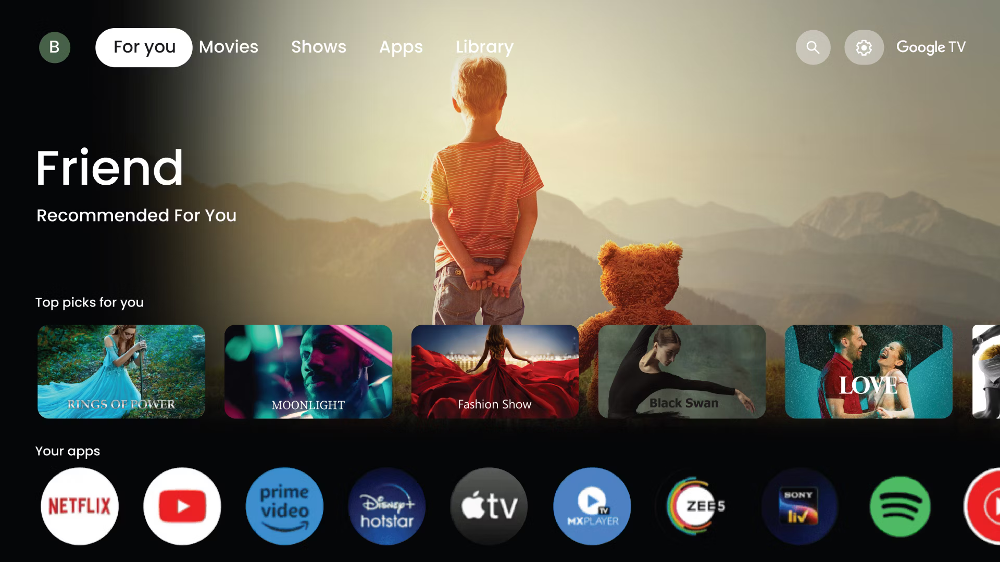
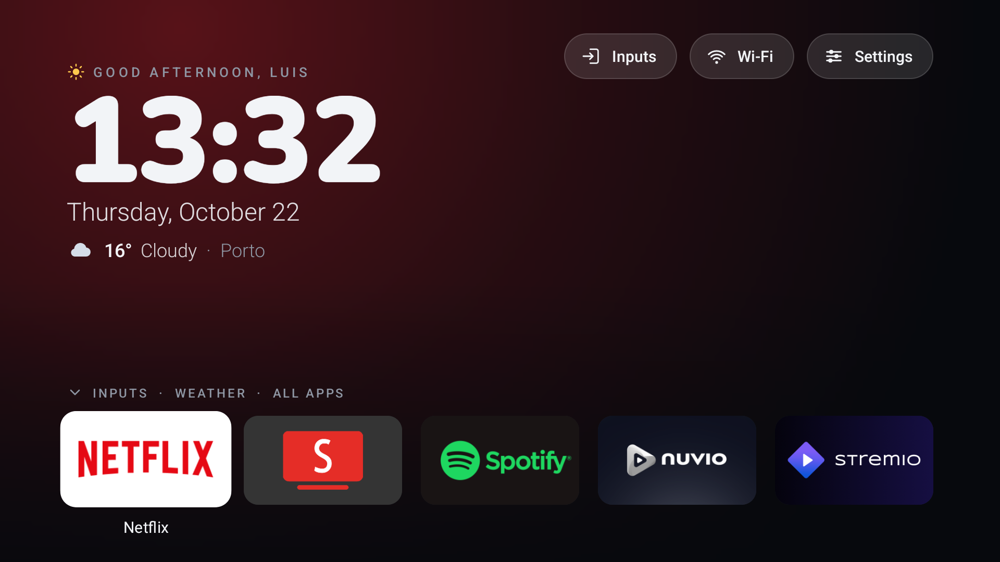
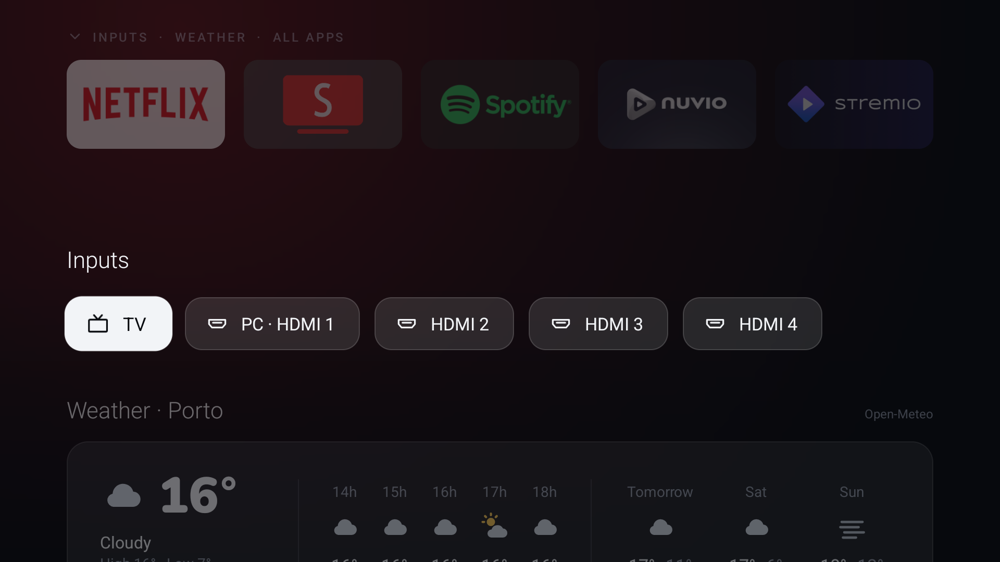
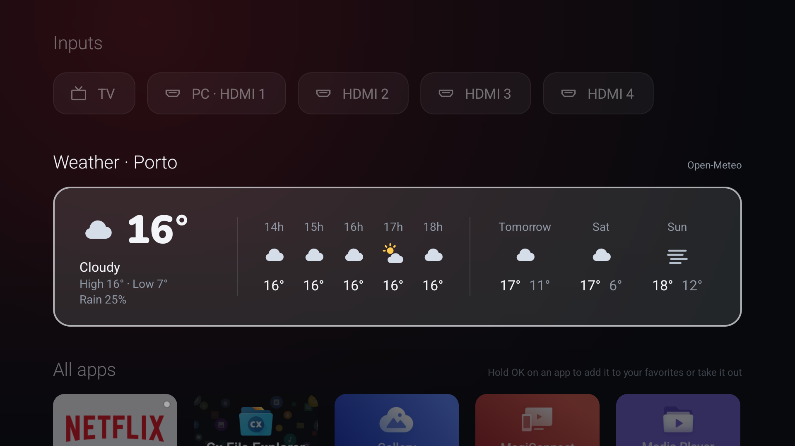
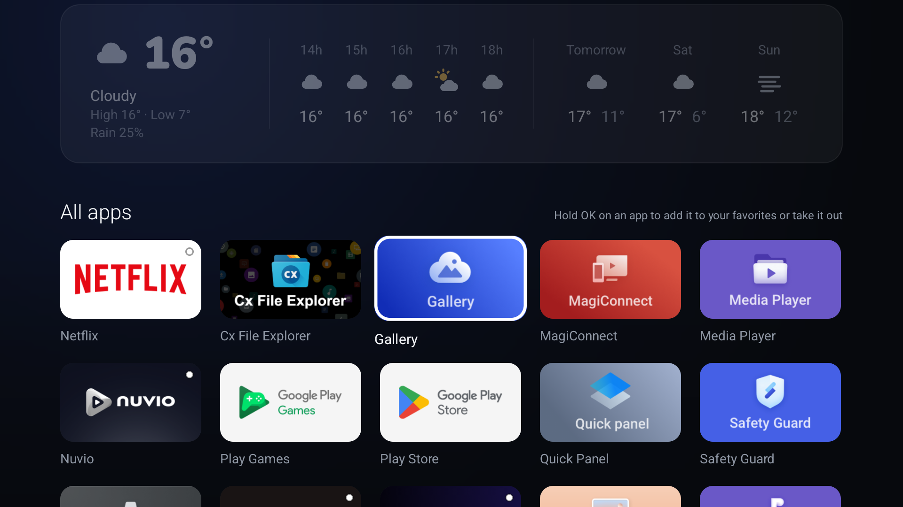

# Bare

**A clean, ad-free home screen for your Android TV or Google TV.**
Your apps, a clock and the weather. Nothing else.

| Before: the stock Google TV home                                                                                                  | After: Bare                                                                                                                                                 |
| --------------------------------------------------------------------------------------------------------------------------------- | ----------------------------------------------------------------------------------------------------------------------------------------------------------- |
|  |  |
| Recommendations, suggested shows and every app the maker put there                                                                | Your apps, a clock and the weather. Nothing else                                                                                                            |

---

## Part 1: For everyone

### What is this?

When you turn on a Google TV or Android TV, the first screen you see is the **home screen**. On most TVs it's full
of ads, "recommended" shows you never asked for and apps the maker put there.

**Bare replaces it with a calm, simple one:**

- a greeting with your name, a big clock, the date and today's weather;
- your favorite apps along the bottom;
- press **Down** on the remote for the TV's inputs (HDMI, antenna), the weather for the next days, and all your apps.

**Nothing is deleted from your TV.** Bare only puts the TV's own home screen to sleep, and can bring it back exactly
as it was whenever you want.

| Press Down: the inputs                                      | Further down: the weather                                                       | And all your apps                                      |
| ----------------------------------------------------------- | ------------------------------------------------------------------------------- | ------------------------------------------------------ |
|  |  |  |

### Will it work on my TV?

| Your TV                                                                                                         |                                                                          |
| --------------------------------------------------------------------------------------------------------------- | ------------------------------------------------------------------------ |
| **Google TV** (TCL, Sony, Philips, Hisense, Xiaomi, Chromecast with Google TV, Google TV Streamer, onn…) | ✅ Yes                                                                   |
| **Android TV**, Android 8 or newer (older Sony, Philips, Xiaomi, NVIDIA Shield, Mi Box…)                 | ✅ It should                                                             |
| **Fire TV** (Amazon)                                                                                      | ⚠️ Only as an app: Amazon doesn't let any other app be the home screen |
| **LG, Samsung, Roku, Apple TV**                                                                           | ❌ No: they don't run Android                                            |

Not sure? On the TV, open **Settings → System → About**. If it says "Android TV OS" or "Google TV", it's a yes.

### Install it: 3 steps, about 10 minutes

You don't need to know anything about computers. An AI assistant does the work for you.

**1. On the TV, allow your computer to connect** (with the remote):

- Open **Settings → System → About**, find **Android TV OS build** and press **OK** on it **7 times**.
  A message says *"You are now a developer"*. *(On some TVs: Settings → Device Preferences → About → Build.)*
- Go back, open **Settings → System → Developer options**, and turn on **USB debugging**.
  *(Despite the name, it works over Wi-Fi: no cable.)*
- Note the TV's **IP address**: **Settings → Network & Internet →** your network. It looks like `192.168.1.50`.

**2. On your computer** (on the same Wi-Fi as the TV), install **[Claude Code](https://claude.com/claude-code)**.

**3. Open Claude Code and say:**

> Set up Bare on my TV: get it from github.com/luisandrelemos/bare-tv and follow its CLAUDE.md.
> My TV's IP is 192.168.1.50. My name is Luis and I live in Porto.

*(Use your TV's IP, your name and your city. The name and city are optional.)*

It installs what it needs, builds Bare and puts it on your TV. When the TV asks **"Allow USB debugging?"**, tick
**Always allow** and press **OK**. That's it: press **Home** on the remote and say hello to Bare. 🎉

### Using Bare

| On the remote                                         | What happens                                                |
| ----------------------------------------------------- | ----------------------------------------------------------- |
| **← →**                                       | Move between your favorite apps                             |
| **OK**                                          | Open the app                                                |
| **↓ Down**                                     | Slide down to the inputs, the weather and all your apps     |
| **↑ Up**                                       | Back up; at the top, the Inputs, Wi-Fi and Settings buttons |
| **Back** or **Home**                      | Back to the top                                             |
| **Hold OK** on an app in "All apps"             | Add it to your favorites, or take it out                    |
| **Hold OK** on a favorite, then **← →** | Move it. **↓** takes it out, **OK** finishes   |

The background takes the color of the app you're on, and the greeting changes with the time of day.

### Change anything, just by asking

Open Claude Code in the same place and say what you'd like, in your own words:

> Make the background pure black.
>
> Hide the apps I never use, like the TCL browser.
>
> Show "YouTube" instead of "SmartTube".
>
> The Settings button on my remote does nothing.
>
> Put my TV back the way it was.

Colors, the glow, which buttons and sections show, a photo as background, what the remote's buttons do: everything
can be changed, and undone.

### Turn off the TV's tracking and ads

Many TVs come with apps that watch what's on screen, upload usage data, push ads and install apps by themselves.
Ask Claude:

> Turn off my TV's tracking, ads and the preinstalled apps I don't use.

It goes through them with you and turns off only what you agree to. Nothing is uninstalled, and "Put my TV back the
way it was" brings everything back.

Two more switches live in the TV's own settings: **Settings → Privacy → Ads** (turn personalization off, or delete
the advertising ID) and **Settings → Privacy → Usage & diagnostics** (off).

### When you're done

Ask Claude to **close the connection** to the TV. It turns debugging off and checks that no other device on your
network can connect to the TV that way. You can always turn USB debugging on again later to change something.

### When something doesn't work

Tell Claude what you see; it knows these. The most common:

- **"Allow USB debugging?" never shows up.** Check USB debugging is on, and the TV is on the same Wi-Fi and not in
  standby.
- **It stops and talks about the Wi-Fi being "saved by the setup wizard".** Nothing was changed, it's being careful.
  On the TV: **Settings → Network & Internet →** your network → **Forget**, join it again, and tell Claude to carry on.
- **A remote button does nothing.** Tell Claude which one: it can find its code and fix it.
- **Holding volume only changes it one step.** Ask Claude to turn off Bare's remote buttons helper.
- **It's a Fire TV.** Bare works as an app, but Amazon never lets another app be the home screen.

---

## Part 2: How it works (the technical part, made simple)

### The big picture

```
 Your computer                                   Your TV
┌───────────────────┐   Wi-Fi (adb)   ┌───────────────────────────────┐
│  tools/tv.py      │ ──────────────► │  Bare (the app)               │
│  builds, installs,│                 │   • the home screen you see   │
│  sends themes,    │                 │   • reads your theme file     │
│  backs up, undoes │                 │   • a tiny helper for the     │
└───────────────────┘                 │     remote's special buttons  │
                                      └───────────────────────────────┘
```

- **Bare** is a normal Android app, written in Kotlin. One line in its manifest tells Android *"I can be a home
  screen"*.
- **`tools/tv.py`** is a Python script on your computer. It talks to the TV with **adb** (Android Debug Bridge), the
  official tool Android developers use: that's what USB debugging allows.
- **[CLAUDE.md](CLAUDE.md)** is the step-by-step guide Claude follows to install and change Bare for you.

### What exactly changes on your TV

| What                                                                                     | Why                                              | Undone by `restore`              |
| ---------------------------------------------------------------------------------------- | ------------------------------------------------ | ---------------------------------- |
| Bare is installed (about 60 KB)                                                          | It's the app                                     | `restore --uninstall` removes it |
| Bare becomes the home screen                                                             | So Home opens it                                 | ✅ The old one comes back          |
| The TV's own home is **disabled** (not deleted)                                    | On Google TV it otherwise keeps taking Home back | ✅ Re-enabled                      |
| Google TV's setup wizard is **disabled**                                           | Once the old home sleeps, it would grab Home     | ✅ Re-enabled                      |
| A small "remote buttons" helper is turned on                                             | Some buttons only worked with the old home       | ✅ Turned off                      |
| Only if you ask: tracking, ad and preinstalled apps are **disabled** (not deleted) | Privacy, and a cleaner TV                        | ✅ Re-enabled                      |
| A backup of the TV's settings, on **your computer** (`backups/`)                 | So everything can be put back                    | Kept for you                       |

Nothing is ever **uninstalled**, and `tv.py` refuses to touch anything the TV needs (picture, sound, inputs, the
remote, Wi-Fi, the keyboard, the Play Store). Every change is **checked** right after, and **rolled back
automatically** if it didn't work.

### Privacy

- **No accounts, no ads, no tracking, no analytics.** Bare doesn't know who you are.
- **The only thing Bare asks the internet is the weather**, from [Open-Meteo](https://open-meteo.com) (free, no
  account), and **only if you set a city**. All it sends is the city's coordinates. Without a city, Bare never goes
  online.
- Your name and city stay in `themes/mine/`, on your computer and your TV, and nowhere else. (To find the city's
  coordinates, setup asks Open-Meteo once, from your computer, with just the city's name.)
- Android's cloud backup is off for Bare: none of its data leaves the TV.
- The remote buttons helper only ever sees the keys it's set to answer; it can't read the screen.
- Leaving debugging on is the one door into the TV that setup opens: `tv.py close` shuts it when you're done.

### Why it's so light and fast

Measured on a real TV with `tv.py bench`: every frame in **~12 ms** (a smooth 60 per second), **~35 MB** of memory,
a **~60 KB** app.

- **No libraries:** only what's already inside Android.
- **The heavy work happens once, in the background:** app pictures are prepared at the exact size they're shown.
- **The graphics chip only gets cheap work:** the colored light behind the apps is one small picture, stretched and
  tinted, not an effect computed for every pixel 60 times a second.
- **Nothing runs when you're not using it:** standing still, Bare draws nothing.

### Different TVs, one app

What changes from TV to TV lives in your theme, not in special code for each brand:

| Difference                         | How Bare handles it                                                          |
| ---------------------------------- | ---------------------------------------------------------------------------- |
| The TV's own home screen app       | `tv.py` finds it by itself (Google TV, Android TV, Xiaomi, TCL, Hisense…) |
| The remote's special buttons       | Codes in your theme; `keys listen` shows what your remote sends            |
| The TV app for antenna and HDMI    | Bare knows the common ones; `live_tv_package` for others                   |
| How inputs open                    | The standard way; `input_action` for the odd TV that needs another         |
| TVs with only "Wireless debugging" | `tv.py pair`                                                               |

Each tested TV gets a page in **[docs/devices](docs/devices/)**. Add yours with `python tools/tv.py report <model>`.

### Doing it by hand

You need Python 3, a JDK 17+ and the Android SDK ([Android Studio](https://developer.android.com/studio) brings both
of the last two). From the Bare folder:

```bash
python tools/tv.py setup
```

It asks the TV's IP, your name and city, then does everything. Change the look in `themes/mine/theme.json` (every
option: [themes/README.md](themes/README.md)) and send it with `python tools/tv.py theme themes/mine`.

| Command                                       | What it does                                                              |
| --------------------------------------------- | ------------------------------------------------------------------------- |
| `setup`                                     | Everything, step by step                                                  |
| `connect` / `pair <address> <code>`       | Connect to the TV; `pair` for TVs with only Wireless debugging          |
| `info`                                      | The TV's model, Android version and current home screen                   |
| `install`                                   | Backs up the TV, then installs or updates Bare                            |
| `home` / `home --takeover`                | Makes Bare the home screen; `--takeover` also puts the old one to sleep |
| `theme <folder>` / `theme --reset`        | Sends a theme, or goes back to Bare's own look                            |
| `favorites` / `favorites set <apps>`      | Shows or sets the favorites row                                           |
| `keys listen` / `keys on` / `keys off`  | Shows the remote's button codes; turns the buttons helper on or off       |
| `disable <app>` / `disable --list <file>` | Puts preinstalled extras to sleep (never deletes; refuses essentials)     |
| `bench`                                     | Measures how smooth Home runs on the TV                                   |
| `report [model]`                            | Writes a page about your TV into `docs/devices/`                        |
| `screenshot`                                | Saves a picture of the TV's screen into `shots/`                        |
| `restore` / `restore --uninstall`         | Puts the TV back exactly as it was                                        |
| `close`                                     | When you're done: turns network debugging off and checks it's closed      |

Turning off a TV's extras: [debloat/](debloat/) has a list per TV family (one app per line, each explained; remove
the `#` in front of optional ones), used as `disable --list debloat/tcl-google-tv.txt`.

Add `--tv <IP>` (or set `BARE_TV=<IP>`) so a command knows which TV.

### What's inside

```
bare-tv/
├── app/              The Android app (Kotlin): the home screen itself
├── tools/tv.py       The installer and helper, run on the computer
├── themes/           Ready-made themes, and yours (mine/)
├── debloat/          Lists of tracking, ad and preinstalled apps to turn off, per TV family
├── docs/devices/     One page per tested TV
├── CLAUDE.md         The guide Claude follows, and notes on the code
└── README.md         This file
```

In `app/src/main/java/.../bare/`, each file does one job: `HomeActivity` (the screen and the remote), `Header`
(greeting, clock, date), `WeatherCard` and `Weather` (the forecast), `Tile` (one app), `Glow` (the colored light),
`Inputs` (HDMI and antenna), `RemoteKeys` (the special buttons), `Theme` (your choices).

Building: `python tools/tv.py build`, or `./gradlew lintRelease assembleRelease`. Contributions are welcome,
especially pages for TVs not in [docs/devices](docs/devices/) yet.

### License

[MIT](LICENSE): free to use, change and share. Bare is an independent project, not affiliated with Google, Amazon or
any TV maker. The clock uses the [Nunito](https://github.com/googlefonts/nunito) typeface (SIL Open Font License).
